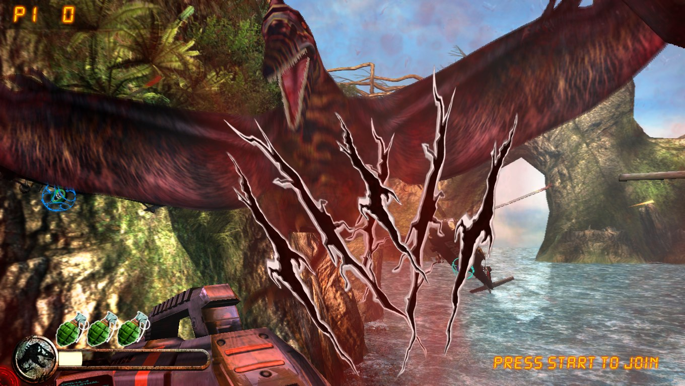
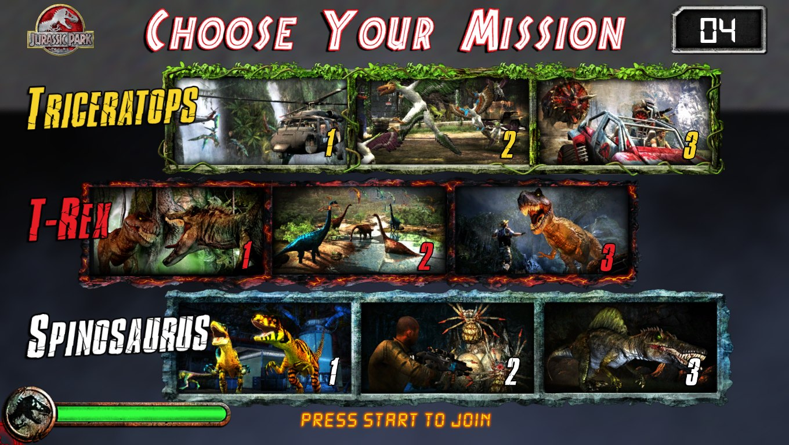
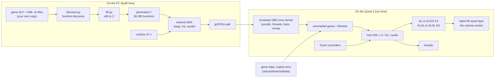

# Jurassic Park Arcade on Meta Quest 3

**Raw Thrills' *Jurassic Park Arcade* (2015), a 32-bit x86 Linux arcade
game, running natively on a standalone Meta Quest 3, with no emulator.**

The whole arcade process (the game plus the i386 Linux libraries it loads)
was **statically recompiled to C** and rebuilt for the Quest's arm64 CPU,
on top of a small emulated Linux kernel. Its desktop OpenGL is translated to
OpenGL ES 3.2, its audio goes to AAudio, and its cabinet hardware (gun I/O
board, HASP dongle) is emulated. The game appears as a big cinema screen in
VR, played with the Touch controllers, at a steady 72 fps.

| On the Quest 3 (frames rendered by the headset) | |
|---|---|
|  |  |

> This repo contains **no game files**. You need your own copy of the game;
> the tools read it from a local folder and nothing from it is committed or
> packaged.

## Highlights

- **Static recompilation of a whole process.** `tools/recomp/lift.py`
  translates **38,285 functions** from the game and 15 Linux libraries
  (glibc 2.19, libstdc++, PhysX 2.8, libtheora, ...) into C: about 575 MB
  of generated source, compiled with the Android NDK into one 91 MB APK.
- **A Linux kernel in user space.** `rt/kernel.c` and `rt/syscalls.c`
  implement the i386 syscalls the game uses (threads via `clone`, futexes,
  files, mmap, signals) on top of a portable platform layer that runs on
  Windows (development) and Android (the headset).
- **Desktop GL to GLES 3.2.** 89 GL entry points mapped to ES; GLSL 1.50
  shaders translated to GLSL ES (all 182 validate with glslang); S3TC/LATC
  textures decoded in software; legacy features emulated (`GL_QUADS`,
  proxy textures, `glGetTexImage`, out-of-order draw buffers).
- **The arcade cabinet, emulated.** HASP HL dongle with program
  decryption, the RIO gun/button I/O board, free play.
- **A real Quest app.** NativeActivity with no Java, OpenXR (sharp quad
  layer with supersampling, mipmaps), AAudio, Touch controller aiming,
  launcher icon, one-command install.
- **Fast enough.** A steady 72 fps in gameplay; the game thread uses about
  7 ms of CPU per frame (budget 13.9 ms).

## How it works



1. **Discovery and lifting.** `discover.py` finds every function in each
   module (symbols, call targets, jump tables, exception tables), and
   `lift.py` turns each x86 instruction into C that operates on guest
   registers and a 4 GB guest address space. Indirect calls go through a
   lookup table; library imports become thunks the runtime can replace.
2. **The runtime** (`tools/recomp/rt/`) loads the original ELF images at
   their arcade addresses, runs `ld.so` and the game's own startup, and
   answers its system calls. Libraries the Quest provides natively (SDL,
   OpenGL, X11) are replaced by host implementations (`hostlibs.c`).
3. **Game-specific hooks** (`hostgame.c`, `host_funcs.txt`) replace a few
   functions: the dongle, the I/O board, and the game's job worker, which
   on the cabinet spun a whole CPU core waiting for work.
4. **On the headset** (`video_android.c`) the game renders into an
   offscreen framebuffer, copied each frame into an OpenXR swapchain shown
   as a 4 m screen. Audio plays from a lock-free ring through an AAudio
   callback.

Deeper notes: [`tools/quest/README.md`](tools/quest/README.md) (the Quest
app, settings, controls, performance, experimental VR) and the running
logs in [`ai_docs/`](ai_docs/).

## Play it on your Quest 3

You need: a Quest 3 in developer mode, a USB cable, a Windows PC, and your
own copy of the game (the Raw Thrills Linux PC build, v1.08).

```sh
sh tools/recomp/build_process.sh   # lift the game + libraries to C (once)
sh tools/quest/build_apk.sh        # build tools/quest/out/jp2015vr.apk
sh tools/quest/install.sh          # install the app; copy the game data the first time
```

Then on the headset: **Library > Unknown sources > Jurassic Park Arcade.**

| Control | Action |
|---|---|
| Right controller | Aim the gun |
| Right trigger | Fire |
| A / X | Player 1 / Player 2 start |
| Right thumbstick up / down | Bigger / smaller screen (remembered) |
| Left thumbstick click | Recentre the screen |

Build prerequisites and every switch are in
[`tools/quest/README.md`](tools/quest/README.md). The same code also builds
a Windows executable for development (`tools/recomp/run.sh`).

## The journey

| Date | Milestone |
|---|---|
| 2026-10-19 | The game boots to attract mode in a self-contained Linux kit under qemu on a Mac: software rendering, 0.07 fps. GOT repair, dongle and I/O emulation in a preload shim (`vr/shim/`). |
| 2026-10-20 | On a Windows PC: the whole process statically recompiled to C and running natively on Windows with GPU rendering, audio and input: playable. Then the GLES 3.2 port, the Android app, and attract-to-gameplay in the Android and Android XR emulators. |
| 2026-10-21 | First run on a real Quest 3. Fixed for the hardware: OpenXR swapchain enumeration, a draw-buffer remap that blurred the 3D scene on Adreno, AAudio pacing and focus muting. Performance work brought gameplay to a steady 72 fps. Packaged as a launcher app. |

Also explored and left switched off: the engine's dormant Oculus DK2
stereo path, driven through OpenXR as full head-tracked VR (it works, but
an on-rails shooter's constant camera motion is uncomfortable in VR). See
"Experimental" in [`tools/quest/README.md`](tools/quest/README.md).

## Repository layout

| Path | What |
|---|---|
| `tools/recomp/` | The recompiler (`discover.py`, `lift.py`, `gen_gl.py`) and the runtime (`rt/`) |
| `tools/recomp/rt/` | Kernel and syscalls, GL/GLES and GLSL translation, audio, platform and video layers, Android entry point |
| `tools/quest/` | APK build, install and data scripts, manifest, icon |
| `ai_docs/` | Running engineering logs and screenshots for each phase |
| `vr/` | The earlier Linux route: preload shim, launch kit, box64 probe, analysis tools |
| `VR_ENGINEERING_PLAN.md` | The original plan |

## Status and next steps

Working: attract mode, mission select, all gameplay tested so far, audio,
P1 gun aiming, free play, 72 fps. Next: player 2 aiming from the left
controller, and more CPU headroom (multi-core guest threads, `-O3`/LTO).

## Legal

A personal interoperability project, built and tested on owned hardware
with an owned copy of the game. No game code, data or patched binaries are
in this repository or in its build outputs' sources; do not redistribute
game files. *Jurassic Park* is a trademark of Universal; the game is by
Raw Thrills. This project is not affiliated with either.
